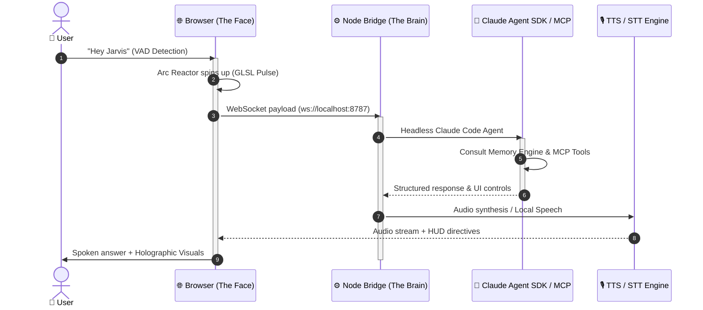

# ⚡ J.A.R.V.I.S. — Holographic Browser AI Assistant

<div align="center">

```
     ___           ___           ___           ___           ___           ___     
    /\  \         /\  \         /\  \         /\  \         /\__\         /\  \    
    \:\  \       /::\  \       /::\  \        \:\  \       /:/  /        /::\  \   
 ___ \:\  \     /:/\:\  \     /:/\:\  \        \:\  \     /:/  /        /:/\ \  \  
/\  \ \:\  \   /:/ /::\  \   /:/  \:\  \   _____\:\  \   /:/  /  ___   _\:\~\ \  \ 
\:\  \ \:\__\ /:/_/:/\:\__\ /:/__/ \:\__\ /::::::::\__\ /:/__/  /\__\ /\ \:\ \ \__\
 \:\  \/ /  / \:\/:/  \/__/ \:\  \ /:/  / \:\~~\~~\/__/ \:\  \ /:/  / \:\ \:\ \/__/
  \:\  /:/  /   \::/__/       \:\  /:/  /   \:\  \        \:\  /:/  /   \:\ \:\__\  
   \:\/:/  /     \:\  \        \:\/:/  /     \:\  \        \:\/:/  /     \:\/:/  /  
    \::/  /       \:\__\        \::/  /       \:\__\        \::/  /       \::/  /   
     \/__/         \/__/         \/__/         \/__/         \/__/         \/__/    
```

### *Just A Rather Very Intelligent System*
**A voice-driven browser assistant featuring an Iron Man holographic Arc Reactor interface powered by Claude Code, Three.js, and Custom GLSL Shaders.**

[](https://react.dev)
[](https://www.typescriptlang.org)
[](https://threejs.org)
[](https://vitejs.dev)
[](https://anthropic.com)
[](LICENSE)

</div>

---

## 🌟 Overview

**J.A.R.V.I.S.** brings the iconic Tony Stark laboratory experience directly to your browser. Say **"Hey Jarvis"**, watch the holographic Arc Reactor spin up, and let him execute real-world actions across your tools — searching the web, generating graphics, controlling your phone, managing notifications, and maintaining continuous long-term memory across sessions.

* **Zero Additional Cloud Cost:** Operates headless via your existing **Claude Code** login through the official Claude Agent SDK.
* **Dual Voice Pipeline:** Instant local voice activity detection (VAD) with natural barge-in (interrupt him anytime) + auto-fallback between local browser speech and ElevenLabs high-definition neural voices.
* **Holographic 3D UI:** Interactive Three.js canvas with procedural audio-reactive shaders, orbital particle rings, and full HUD HUD-class visual controls.

---

## ✨ Personalized Capabilities & Extensions

This edition includes deep customized features and architecture enhancements:

* 🧠 **Persistent Memory Engine:** Structured personal memory layer feeding Claude context dynamically, prioritizing past decisions, routines, and user preferences before daily external inputs.
* 📱 **Seamless Mobile Pairing:** High-contrast QR-code authentication with Lax-cookie handshakes for lag-free remote browser control directly from smartphones.
* 🎙️ **Beam-5 Acoustic Hearing:** Low-latency acoustic model tuning with custom vocabulary recognition for rapid wake-word activation and phrase isolation.
* ☀️ **Geographic Context & Briefing:** Direct coordinate geolocation fallback (`JARVIS_LAT/LON`), morning agenda briefings, focus screens, and habit alerts.

---

## 🏗️ Architecture & Interaction Flow



---

## 🚀 Quickstart

### Prerequisites
1. **Node.js 20+** installed (<https://nodejs.org>)
2. **Claude Code installed and authenticated**:
   ```bash
   npm install -g @anthropic-ai/claude-code
   claude
   ```
3. **Google Chrome or Microsoft Edge** (with microphone permissions enabled).

---

### Installation & Launch

```bash
# 1. Clone your repository
git clone https://github.com/TassioSales/jarvis.git
cd jarvis

# 2. Install dependencies
npm install

# 3. Start Brain and Face concurrently
npm start
```

Alternatively, run in separate terminals:

```bash
# Terminal 1 — The Brain (WebSocket Bridge)
npm run bridge

# Terminal 2 — The Face (Vite Frontend)
npm run dev
```

Then open **`http://localhost:5173`** in Chrome, click **INITIALISE**, allow microphone access, and say:

> *"Hey Jarvis, what's on my schedule today?"*

---

## 🎮 Voice & Keyboard Controls

| Trigger | Action |
| :--- | :--- |
| **"Hey Jarvis"** | Awakens the assistant and initiates active listening |
| **Spacebar** | Push-to-talk without uttering the wake word |
| **Speak Mid-sentence** | Immediate barge-in — Jarvis stops talking and listens to you |
| **`V` key** | Cycles through available synthetic and neural voices |
| **`D` key** | Toggles live hardware & latency diagnostics overlay |
| **`T` key** | Executes an end-to-end audio self-test pipeline |
| **`Esc` key** | Stand down / clears current task |

---

## 🛠️ MCP Tool Ecosystem

Jarvis natively inherits every MCP server defined in your `~/.claude.json`:

* 🔍 **Research & Web:** `exa`, `serper`, `serpapi`
* 🎨 **Media Generation:** `higgsfield`, `openrouter-image`, `palmier-pro`
* 📱 **Mobile Automation:** `android`
* 🌐 **Headless Browsing:** `playwright`
* 🎛️ **Interface Controls:** `ui_theme`, `ui_reactor`, `ui_orbit`, `ui_chrome`, `ui_effect`, `ui_screen`

---

## ⚙️ Environment Configuration

Copy `.env.example` to `.env.local` to customize ports and optional external keys:

```ini
# Core Bridge Settings
JARVIS_BRIDGE_PORT=8787
JARVIS_MODEL=claude-opus-5
JARVIS_EFFORT=medium

# Geolocation Coordinates (Override IP Geolocation)
JARVIS_LAT=-23.5505
JARVIS_LON=-46.6333

# Optional: ElevenLabs High-Definition Neural Voice
ELEVENLABS_API_KEY=your_key_here
JARVIS_VOICE_ID=your_voice_id_here
```

---

## 👨‍💻 Author & Maintainer

Maintained and enhanced by **Tássio Sales**  
* GitHub: [@TassioSales](https://github.com/TassioSales)  
* Specialized in Autonomous AI Agents, Real-Time Interactive Interfaces, and Full-Stack Engineering.

---

<div align="center">
<sub>Built with inspiration from Tony Stark's iconic AI. Licensed under the MIT License.</sub>
</div>
